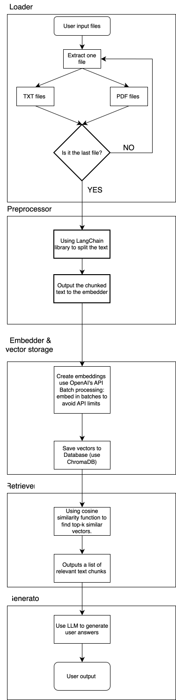

# Architecture #  

## MVP scope ##

### What to include ###  

- Text and PDF note ingest  
- Chunking + embedding storage  
- Query retrieval from a vector store  
- Answer generation via an LLM  
  
## Stack for the project ##

- Python 3.10+
- OpenAI for embeddings + responses  
- LangChain for the RAG pipeline  
- ChromaDB for vector storage  

## List of libraries ##

```bash  
langchain 
openai
chromadb
fastapi, uvicorn
pytest 
```

## Flow of the construction ##

